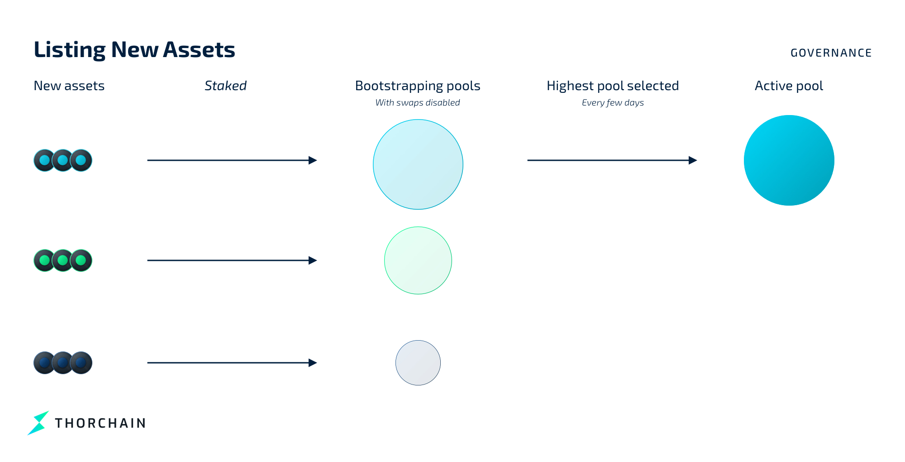

# Governance

THORChain aims to have as little governance baked into the system as possible. This prevents nodes from coordinating or learning who one another are, which improves security by making collusion difficult.

THORChain governance decides:

- which assets are listed or delisted
- which chains are listed or delisted
- when the protocol is upgraded

## Asset Listing

Users signal which assets they want on the network by staking into a new pool. THORChain will recognise it as a new asset and create a pool in _bootstrap mode_ (swapping disabled).
Every few days the network checks all bootstrap pools and lists the one with the most value.

### Asset Delisting

Assets are delisted automatically when their liquidity falls too low:

1. New bootstrap pools are compared to the smallest active pools.
2. If a bootstrap pool is deeper, the smallest active pool is returned to bootstrap mode and replaced.
3. Assets can later be re-listed if liquidity returns.

## Chain Listing and Delisting

To add a new chain:

1. Community developers write a new Bifröst module and propose it via a [THORChain Improvement Proposal (TIP)](https://dev.thorchain.org/architecture/).
2. The developer community reviews and decides whether to accept it.
3. If accepted, code is tested and added to THORNode.
4. Nodes upgrade as they churn in and out.
5. When 67% of nodes run the new software, the chain connects.

To delist a chain, nodes stop watching it. Once 67% of nodes are no longer watching, the chain is removed and assets are returned to users.

## Mimir - Network Settings

THORChain operates with a set of constants that define fees, limits and security thresholds. Constants are set within the network however some can be overridden through Mimir. Some other Network settings are Mimir only. 

Live values:

- [Network Constants](https://gateway.liquify.com/chain/thorchain_api/thorchain/constants)
- [Mimir Settings](https://gateway.liquify.com/chain/thorchain_api/thorchain/mimir)

See [Constants and Mimir](https://dev.thorchain.org/mimir.html) within the developer documentation for a description of each one.

### Mimir Types

Mimir values can be changed by Node operators voting and the amount of votes required to change a Mimir value depends on its type. 

Operational Mimirs are the network controls a few active nodes can change without a supermajority. Examples are [halts](https://dev.thorchain.org/concepts/network-halts.html) and the 'REVSHARE' Mimirs.
The value with more votes than any other wins, and only with at least `OperationalVotesMin` votes. A tie, or votes below `OperationalVotesMin`, leaves the stored value as it is. The node vote is still recorded. `OperationalVotesMin` is a network constant set to 3 but see the live values for the latest values. Changing it takes the economic vote.

Economic Mimirs are network controls that have a significant impact on the network or its economics. They generally are fees, economic management, node management, and limits. A change needs a 2/3 supermajority of the active nodes on the same value, rounded up (`signers >= ceil(2N/3)`), e.g. 66 of 99 or 67 of 100 nodes. Economic Mimirs generally override network constants set in the code.

How a node votes is in [Node Voting](../thornodes/overview/#node-voting).

## Change Management

Protocol-level changes use **Architecture Decision Records (ADRs)**. An ADR should describe:

- context and goals
- the proposed change
- pros and cons
- references
- changelog

Process and status can be found here:

- [ADR Process](https://dev.thorchain.org/architecture/PROCESS.html)
- [Current ADRs](https://dev.thorchain.org/architecture/index.html)

## Emergency Changes

Nodes cannot directly coordinate, which makes emergency changes difficult. In critical cases the **Ragnarök protocol** is used:

1. Nodes begin to leave the system.
2. When fewer than 4 nodes remain, Ragnarök triggers.
3. All funds are automatically returned to users.
4. The network shuts down safely and can be restarted later.

Halt and pause steps are in [Emergency Procedures](../thornodes/emergency-procedures.md), and what a halt stops is in [Network Halts](https://dev.thorchain.org/concepts/network-halts.html).

## Governance Philosophy

THORChain’s governance is minimal by design:

- avoids coordination between nodes
- reduces attack and capture risk
- lets market forces drive asset and chain selection
- reduces human overhead and governance fatigue
- keeps the system self-regulating and secure
