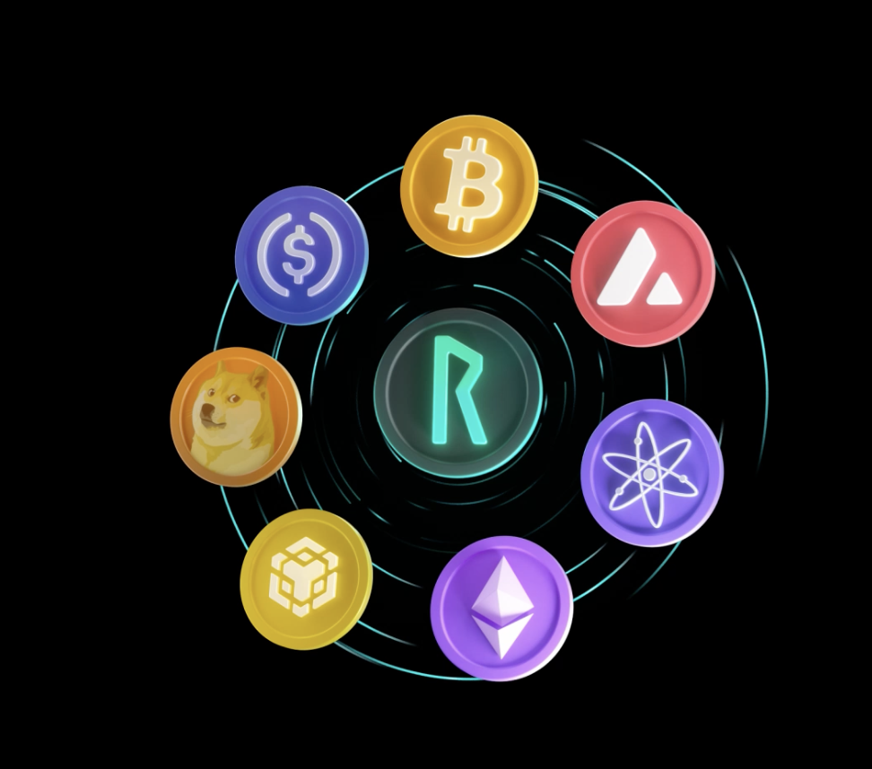

# What is THORChain, RUNE, and TCY?

THORChain is a Layer-1 blockchain that enables different cryptocurrencies to work together. It acts as a decentralized exchange (DEX) that allows you to swap coins across different blockchains in a single step.

Every swap on THORChain happens directly from your wallet in a safe and permissionless way.
THORChain doesn't hold your funds—though it does retain your inbound asset briefly during the swap before immediately sending you the output asset. You never give up custody to a centralized entity.

Unlike centralized exchanges:

- You don't need an account
- There is no KYC or paperwork
- You don't have to trust a company to hold your funds

Example:
If you own Bitcoin and want Ethereum, you just send Bitcoin from your wallet and receive Ethereum back in a single transaction — no exchange accounts, no middlemen.

<!-- trunk-ignore(markdownlint/MD033) -->

<!-- trunk-ignore(markdownlint/MD033) -->
  

## Supported Blockchains

THORChain enables native swaps between the following major blockchains:

- Bitcoin (BTC)
- Ethereum (ETH)
- BNB Smart Chain (BSC)
- XRP Ledger (XRP)
- Solana (SOL)
- Tron (TRX)
- Zcash (ZEC)
- Dogecoin (DOGE)
- Monero (XMR) — coming soon
- Bitcoin Cash (BCH)
- Litecoin (LTC)
- Avalanche (AVAX)
- Base (BASE)
- Cosmos Hub (ATOM)


Chain availability can change, and individual chains are sometimes paused. Check the live [inbound addresses](https://gateway.liquify.com/chain/thorchain_api/thorchain/inbound_addresses) endpoint for current status.


## Supported Stablecoins

Stablecoins are swapped natively on the chains that issue them. THORChain currently has pools for:

- Tether (USDT) — Ethereum, BNB Smart Chain, Avalanche, Tron
- USD Coin (USDC) — Ethereum, BNB Smart Chain, Avalanche, Base
- Dai (DAI) — Ethereum
- Gemini Dollar (GUSD) — Ethereum
- Liquity USD (LUSD) — Ethereum
- Pax Dollar (USDP) — Ethereum

The live [pools](https://gateway.liquify.com/chain/thorchain_api/thorchain/pools) endpoint shows every available asset.

THORChain will continue to evolve and add more chains over time, so users will be able to swap even more popular cryptocurrencies, all without wrapped tokens or intermediaries.

THORChain is a full blockchain (like Ethereum or Solana). This means that, in addition to swapping, developers can build smart contracts and decentralized apps (dApps) on top of it. This makes THORChain not only a trading tool but also a foundation for the next generation of DeFi projects.

## What is RUNE?

RUNE is the native utility token of THORChain that serves four critical functions:

### 1. Settlement Asset

- All transactions and swaps in the network are settled in RUNE
- RUNE acts as the bridge connecting all supported blockchains

### 2. Network Security (Bonding)

- Validators must bond RUNE to participate in consensus
- More bonded RUNE makes the network harder to attack
- Running a node allows earning a share of THORChain's revenue

### 3. Liquidity

- RUNE is present in every liquidity pool (BTC–RUNE, ETH–RUNE, etc.)
- This ensures unified pricing and constant demand for RUNE

### 4. Governance and Incentives

- Validators and liquidity providers earn rewards in RUNE
- These rewards come from real network fees, not token inflation
- Active node operators vote on network parameters via [Mimir](technical-deep-dive/governance.md#mimir-types)

## What is TCY?

The TCY (THORChain Yield) token was created to resolve THORChain's debt issue (~$210M) after the THORFi crisis in January 2025.

Each $1 of debt was converted into 1 TCY. This way, creditors received tokens instead of a total loss, giving them the right to a share of the network's future revenue. This helped stabilize the ecosystem and align the creditors' interests with the protocol.

### How does TCY work?

TCY stakers receive 10% of THORChain's system income (block rewards plus liquidity fees), paid in RUNE.

Stakers retain their yield, while the yield from unclaimed or unstaked TCY is forfeited and redirected to buy TCY, and held by the protocol (protocol owned TCY).

A RUNE/TCY liquidity pool was created, so the token can be freely traded. Fees from this pool are used to buy TCY and held as protocol-owned TCY.

The yield from protocol-owned TCY is used to buy more TCY and held within the protocol, further compounding the TCY held and locked within the protocol.

⚠️ TCY does not provide voting rights or influence in the governance of the THORChain network – it is solely an income-generating economic token.
